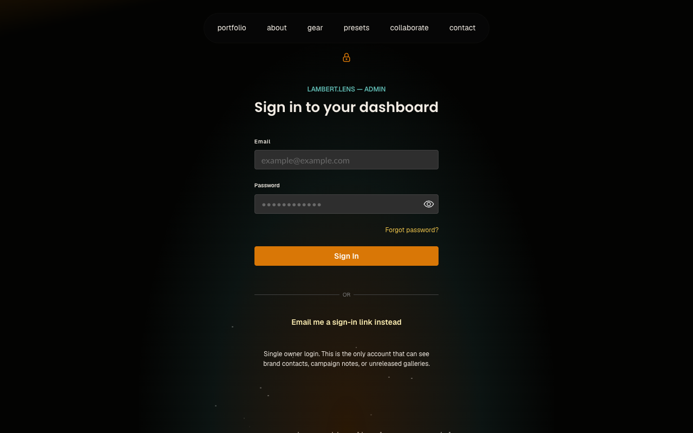
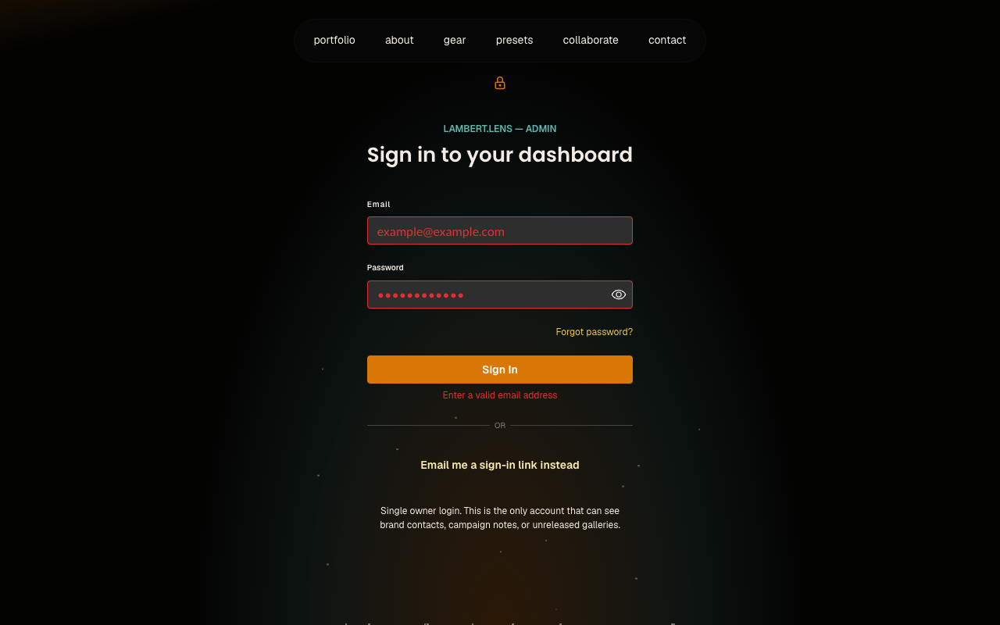
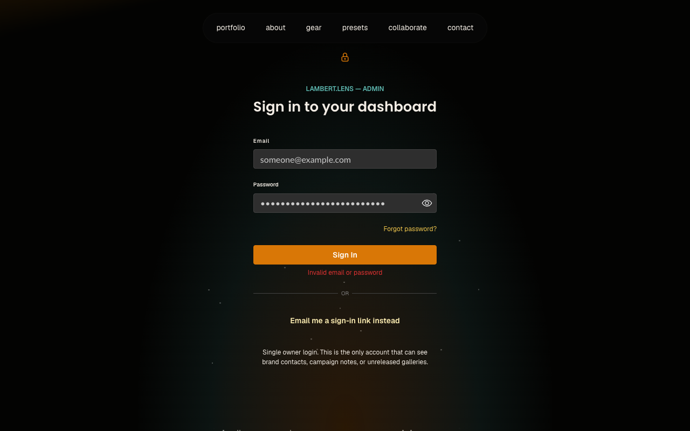
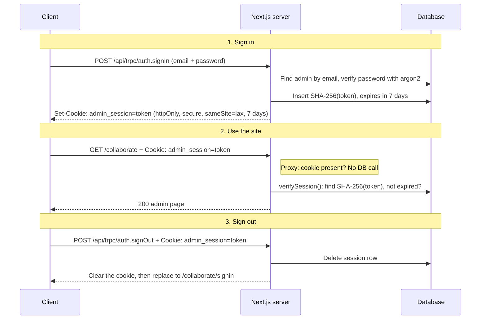

# Admin Authentication: Cookie Session Flows

Admin pages under `/collaborate` are protected by a database-backed session.
The client holds a random token in an HTTP-only cookie (`admin_session`); the
database only stores its SHA-256 hash.

Each screenshot below is a screen the browser ends on, with the routes that
lead to it.

## Sign-in form

- `/collaborate/signin` with no valid session: the form renders.
- `/collaborate` (or any protected path) with no cookie: the proxy redirects
  to `/collaborate/signin`.
- `/collaborate` with an expired or forged cookie: `verifySession()` redirects
  to `/collaborate/signin`.
- Sign out on `/collaborate`: `router.replace("/collaborate/signin")`.

## Request page

- `/collaborate/request`: a public path, so the proxy lets it through with or
  without a cookie.

## 404 page

- `/collaborate/review`: a public path, so the proxy lets it through, but no
  page exists there yet.

## Sign-in form: validation error

- Submitting the form on `/collaborate/signin` with an empty or invalid email:
  Zod stops it in the browser, so no request is sent.

## Sign-in form: wrong email or password

- Submitting the form on `/collaborate/signin` with a wrong email or password:
  `POST /api/trpc/auth.signIn` returns `UNAUTHORIZED`.

## How the cookie works

The client only ever holds the raw token, and the database only stores its
SHA-256 hash, so a leaked sessions table can't be used to sign in. The proxy
does a cheap cookie check on every request; `verifySession()` does the real
database check before an admin page renders.

## Rate limiting

Sign-in attempts are limited per IP address, so passwords can't be guessed
without limit. The limits live in `server/rateLimit/rateLimit.constants.ts`:

| Endpoint                              | Limit                     |
| ------------------------------------- | ------------------------- |
| `auth.signIn`                         | 5 attempts per 15 minutes |
| `auth.requestMagicLink` (coming next) | 3 requests per 15 minutes |

- The `rateLimit(name)` tRPC middleware runs before the input is validated
  and before the password check. Over the limit, it throws
  `TOO_MANY_REQUESTS` (HTTP 429), and the form shows "Too many attempts.
  Please try again in 15 minutes." under the button.
- Counts live in the `auth_rate_limits` table, one row per `name:ip`
  (`db/migrations/015_auth_rate_limits.sql`). A single
  `INSERT … ON CONFLICT DO UPDATE` adds 1, or starts a new window once the
  old one has expired, so simultaneous requests can't slip past the limit.
- The IP comes from the first entry of `x-forwarded-for`, which Vercel sets
  itself. Locally it's `::1`.
- The daily cron deletes rows older than a day.
- To unblock yourself while testing, run `delete from auth_rate_limits;` in
  the Neon SQL Editor.

## Where the code lives

- **proxy.ts** — cookie-only check for every request under `/collaborate`.
- **server/session/session.ts** — `createSession()`, `getSession()`,
  `verifySession()`, `redirectIfSignedIn()`, `deleteSession()`.
- **server/trpc/routers/auth.ts** — `auth.signIn` and `auth.signOut` mutations.
- **server/trpc/trpc.ts** — `protectedProcedure` guards admin tRPC calls, which the
  proxy doesn't cover.
- **server/trpc/trpc.ts** — `rateLimit(name)` middleware limits attempts per IP.
- **server/rateLimit/rateLimit.ts** — `consumeRateLimit()` and `getClientIp()`; the
  limits themselves are in **server/rateLimit/rateLimit.constants.ts**.
